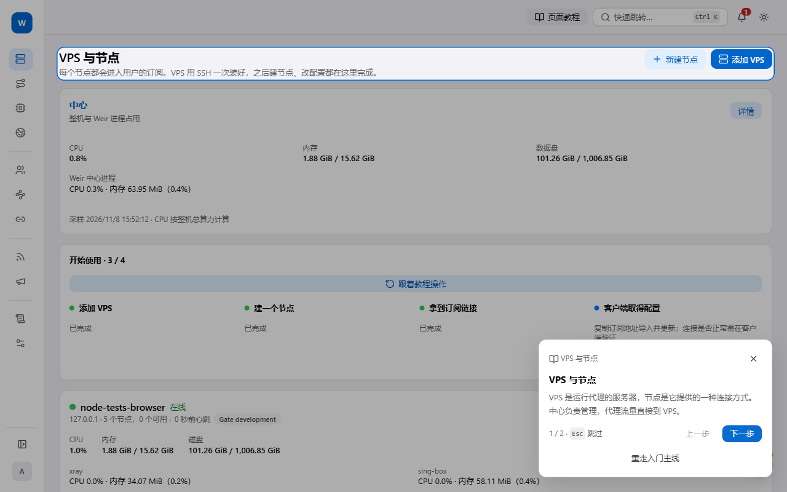
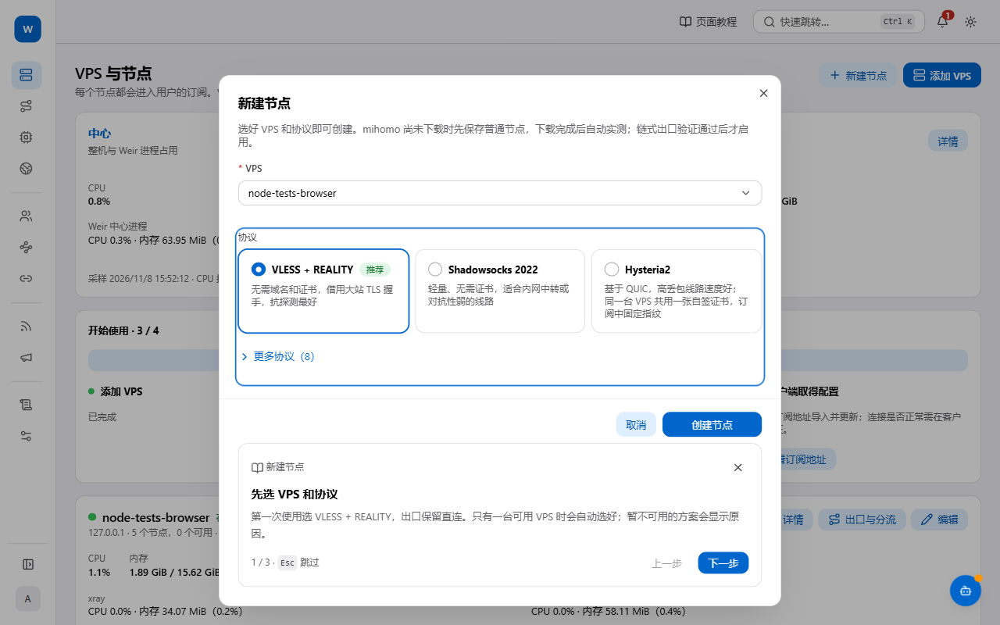
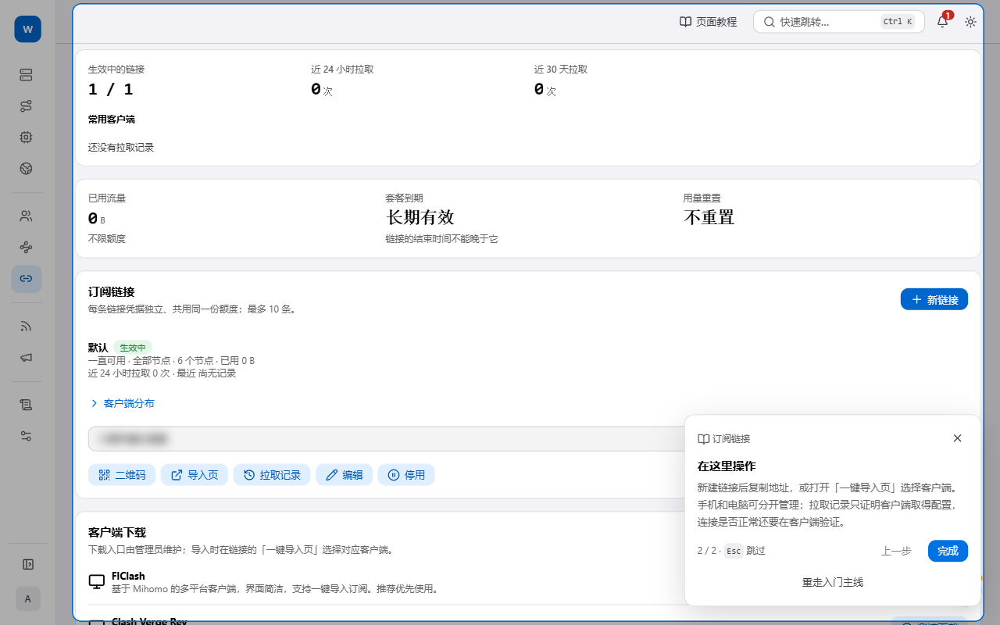
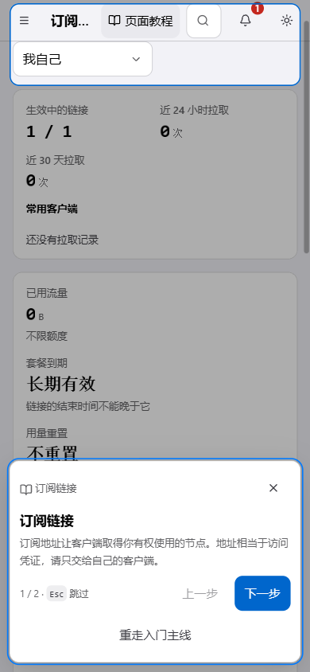

# Weir

个人使用的代理管理面板，合并 [MiGate](https://github.com/imzyb/MiGate)（Gate 设备、Xray / sing-box 内核管理）与原来的订阅管理（JS 版，已逐文件迁移到 Go）。中心管理用户、节点和订阅；Gate 在 VPS 上运行内核，代理流量直达 Gate，不经过中心。


只发布一个程序 `weir`，按安装角色运行：

| 角色 | 用途 |
| --- | --- |
| `standalone` 单机 | 中心 + 本机 Gate，一台 VPS 就能用；中心初始化后本机 Gate 自动配对 |
| `center` 中心 | 只装中心，Gate 装在其他 VPS 上 |
| `gate` | 只装 Gate，由中心配对和下发配置 |

## 安装

```sh
curl -sSL https://raw.githubusercontent.com/shusfun/weir/main/deploy/install-online.sh | bash
```

脚本依次询问语言、角色和中心监听地址（默认 `127.0.0.1:19810`），按本机架构（amd64 / arm64）从 GitHub Release 下载安装包，目标机器不编译。没有终端（如 SSH 直接执行）时不提问，用默认值。直连 GitHub 低于 100 KiB/s 持续 15 秒时依次改用 `gh-proxy.com`、`ghfast.top`、`ghproxy.net`、`gh.llkk.cc`；校验和始终直连 GitHub 获取，镜像返回的包校验不一致就丢弃。`WEIR_GITHUB_MIRRORS=off` 关闭镜像，也可以写逗号分隔的主机名替换默认列表。

装好后，中心的所有 GitHub 下载（内核、Gate 安装包、中心与 Gate 自更新、客户端安装包）都按「系统设置 → 版本与下载 → GitHub 加速」里排好的来源顺序：GitHub 直连、加速镜像（前缀 + GitHub 地址，兼容 gh-proxy，可以自建）、经某台 VPS 中转。同样是连续 15 秒低于 100 KiB/s 就换下一个，内容一律按 GitHub 官方摘要校验。


中心只接受 HTTPS（本机回环直连除外）。保持监听 `127.0.0.1`，在 1Panel 等本机反代里把域名指向这个地址并配好证书，反代需要转发 `Host` 和 `X-Forwarded-Proto`。安装时不问域名，管理员第一次用域名打开控制台时自动记下。

## 初始化

用 `https://域名` 打开控制台进入安装向导：验证初始化凭证 → 选择存储 → 创建管理员。

- 安装结束时打印初始化凭证，30 分钟有效。找不到或过期时执行 `weir` 选 `6`：没过期就照旧显示，过期了自动换新；`7` 强制换新。
- 存储默认只用 SQLite。选 PostgreSQL + Redis 时，中心会探测本机实例；认出 1Panel 装的就填好地址、账号和推荐的空库，密码框留空即可，密码由中心直接读取，不经过浏览器。中心只使用 `weir` schema 和 `weir:` 前缀。
- 已有 Weir 账户的库不能重新初始化：要继续用原来的数据请恢复原配置文件，否则换一个空库。
- 也可以在终端完成：`weir` 菜单 `5`，或 `weir center --setup`。

## 新手教程

首次登录后，点击欢迎卡片的「开始教程」；管理员也可从 VPS 页「开始使用」中的「跟着教程操作」重走入门主线。教程会介绍安装初始化、VPS、VLESS + REALITY 节点、端口与实测，再到订阅导入客户端。

- 随时按 **Esc** 或点跳过退出教程，已填表单、业务弹窗和后台任务都会保留。
- 顶栏「页面教程」可按当前页面、标签重新开启；弹窗右上角也有教程入口。初始化、登录及公开导入页提供就地帮助。
- 教程状态按账户和角色保存在当前浏览器。已完成或跳过的教程不会反复提示；内容更新时只显示「教程有更新」，手动打开即可。
- 操作步骤等待实际成功结果，失败时留在当前步骤；目标尚未出现时可重新定位或跳过。已有资源可以继续使用，重放教程不会自动创建资源。
- **订阅拉取成功只表示取得配置**；请在客户端选择节点、开启代理并实际访问，单独验证连接。

以下截图来自隔离的本地演示环境，使用虚构数据；凭据与二维码已遮蔽。



VPS 页面：从服务器上线和节点状态开始。



创建节点：教程保留真实表单，由你确认创建。



订阅链接：从导入入口交给自己的客户端，随后单独验证连接。



手机：教程在窄屏显示，支持随时退出和重新开启。

## 添加 Gate

在控制台的 VPS 页面点「添加 VPS」，把生成的一行命令粘贴到目标 VPS 上执行：它从中心下载同版本程序、安装 Gate 角色并配对；命令带上「GitHub 加速」里的镜像（`WEIR_GITHUB_MIRRORS`）。命令里的配对凭证 1 小时有效，只能用一次。Gate 主动连接中心，不开放公网管理接口。中心校验并保存发行档案，Gate 按档案优先从 GitHub 或镜像下载内核，校验归档摘要与二进制架构后再安装；失败才从中心限速缓存续传。GitHub 发布信息由 Gate 查询、中心校验，模型与内核正常下载不回传中心；「经 VPS 中转」用于中心自用文件的最终兜底。

## 日常维护

root 在终端执行 `weir` 打开中文菜单：服务状态、启动、停止、重启、重设管理员密码（不需要旧密码，并撤销该管理员的全部登录）、卸载。

更新：控制台「系统设置 → 版本与下载」里点更新（要当前密码与二次验证码）。由 root 的 `weir-update` 服务自己从 GitHub 下载、按官方摘要校验、安装，启动失败自动切回；也可以切回上一版本。Gate 随后自动跟随到同一版本：自己从 GitHub 下载（失败退回从中心下载），失败后 10 分钟内不自动重试；VPS 卡片上可以手动「更新到 x」。终端里也可以：

```sh
weir self-update --version 0.1.14          # 以 root 更新到指定版本；--rollback 切回上一版本
bash install-online.sh upgrade             # 用安装脚本升级到最新正式版
bash install-online.sh install -v v0.1.10   # 安装或切换到指定版本
bash install-online.sh rollback v0.1.9      # 回退
bash install-online.sh list-versions        # 列出 GitHub Release

journalctl -u weir-center -f              # 中心日志；Gate 为 weir-gate，内核辅助程序为 weir-helper
weir version
```

每次安装保留上一个版本，启动失败时自动切回。

## 卸载

`weir` 菜单 `8`，或：

```sh
curl -sSL https://raw.githubusercontent.com/shusfun/weir/main/deploy/install-online.sh | bash -s -- uninstall
```

两种方式都先确认，再问是否同时删除配置和数据，默认保留。没有终端时要写 `-y`，删除数据要写 `--purge`。PostgreSQL 的 `weir` schema、Redis 的 `weir:` 键、数据库实例、1Panel、反代和 x-ui 都不会动。

## 目录

| 路径 | 内容 |
| --- | --- |
| `/opt/weir` | 程序（`releases/<版本>`，`current` 指向当前版本）与 Gate 托管的内核 |
| `/etc/weir` | 配置；`center/setup-token` 是初始化凭证，仅 root 可读 |
| `/var/lib/weir` | 数据：SQLite 数据库、内核缓存、Gate 状态、dsh；`update/` 是自更新的请求与进度 |
| `/usr/local/lib/weir/install.sh` | 本机安装脚本，升级、回退和卸载都由它执行 |

## 开发


```sh
pnpm install --frozen-lockfile && pnpm dev   # 控制台 127.0.0.1:22340，接口代理到 127.0.0.1:22341
pnpm check && pnpm build                     # 类型检查；构建到 apps/weir/static
go build ./... && go vet ./... && go test ./...
CGO_ENABLED=0 GOOS=linux go build -o dist/weir ./apps/weir
```

发布：公开仓库的 `v*` 标签触发 GitHub Actions，检查源码后构建 linux/amd64 与 linux/arm64 包并创建 Release。公开仓库的 `VERSION` 保持为该次发布版本。
